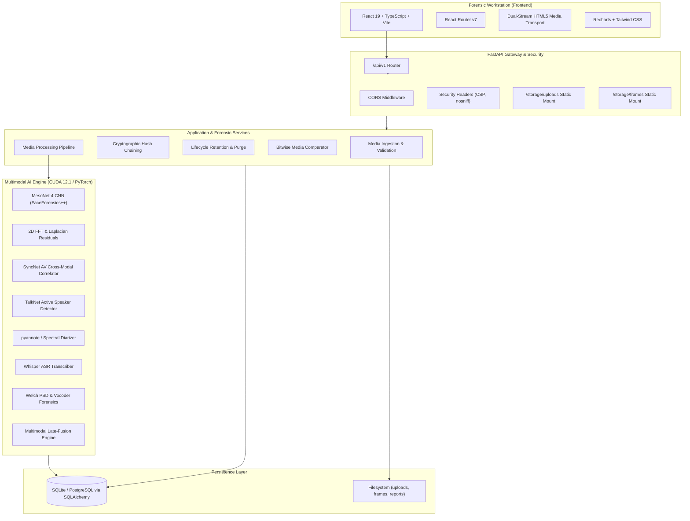
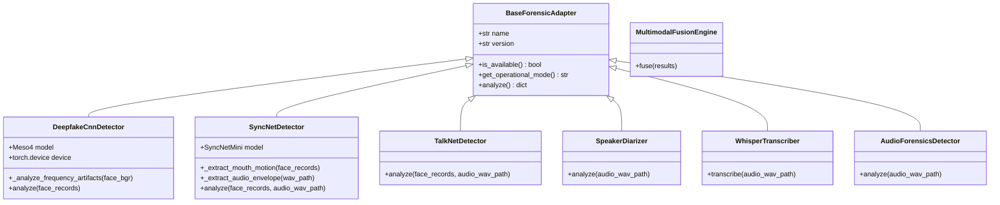

# System Architecture: VerifAI Platform

**VerifAI** is a multimodal deepfake detection and media verification platform engineered for digital forensics examiners, academic researchers, and regulatory auditors. It combines computer vision, acoustic signal processing, cross-modal audio-visual synchronization, and cryptographic audit logging to evaluate digital media integrity.

---

## 1. High-Level Architectural Overview

The platform uses a decoupled microservices architecture with a React/TypeScript forensic workstation on the frontend and an asynchronous Python/FastAPI service orchestrating GPU-accelerated deep learning models and analytical signal processing routines.

---

## 2. Frontend Architectural Specification

- **Framework**: React 19 with TypeScript, compiled via Vite.
- **Styling**: Tailwind CSS adhering to a digital forensics design language (dark charcoal `#0B0F19`, slate cards `#111827`, electric blue `#6366F1`, and cyan `#06B6D4` accents).
- **Navigation Structure**:
  - **Workspace**: Command Center (`/`), New Investigation (`/investigations/new`), Investigation History (`/investigations`), Investigation Details (`/investigations/:id`).
  - **Forensic Laboratory**: Video Forensics Lab (`/lab/video/:id?`), Audio Forensics Lab (`/lab/audio/:id?`), Audio-Video Sync Lab (`/lab/sync/:id?`), Media Comparison Lab (`/lab/compare`), Evidence Explorer (`/evidence/:id?`).
  - **AI Intelligence**: Model Registry (`/models`), Evaluation Center (`/evaluation`), System Monitor (`/system`).
  - **Management**: Forensic Reports (`/reports/:id?`), Chain of Custody Audit Trail (`/audit`), Platform Settings (`/settings`).
- **Media Player Engine**: Frame-stepping video transport, synchronized bounding-box rendering, live ROI filmstrips, interactive audio waveform scrubbers, and audio-video dual-stream concordance players.

---

## 3. Backend & API Gateway Specification

- **Framework**: FastAPI (Python 3.11+), running under ASGI Uvicorn.
- **Security Middleware**:
  - `X-Content-Type-Options: nosniff`
  - `X-Frame-Options: SAMEORIGIN`
  - `X-XSS-Protection: 1; mode=block`
  - `Referrer-Policy: strict-origin-when-cross-origin`
- **File Ingestion Protection**:
  - Extension whitelisting (`settings.allowed_extensions_set`).
  - Binary magic byte validation (`validate_file_signature`).
  - SHA-256 integrity digests computed in 64KB blocks.
  - Collision-proof randomized filename generation with UUIDv4.
  - Path traversal neutralization via `ensure_safe_path`.

---

## 4. AI/ML Inference Pipeline & Adapters

VerifAI adopts a **Unified Forensic Adapter Pattern** where all analytical engines inherit from `BaseForensicAdapter` and self-report their operational status:
- `active_model`: Pretrained neural checkpoint loaded and operational on CUDA GPU or CPU.
- `baseline_heuristic`: Signal processing and analytical computer vision baseline when neural weights are unpopulated.
- `mock_adapter`: Isolated test harness simulation.
- `unavailable`: Hardware or runtime prerequisite unsatisfied.

### Fusion Engine Decision Matrix
The multimodal score $S_{total}$ is calculated as a calibrated weighted combination:
$$S_{total} = w_v \cdot S_{facial} + w_s \cdot S_{sync} + w_a \cdot S_{active} + w_u \cdot S_{audio}$$
Where default weights are $w_v = 0.35, w_s = 0.25, w_a = 0.20, w_u = 0.20$.
- $S_{total} < 0.35$: **LOW EVIDENCE OF MANIPULATION** (Nominal authenticity).
- $0.35 \le S_{total} < 0.60$: **INCONCLUSIVE** (Borderline anomalies present).
- $S_{total} \ge 0.60$: **POTENTIAL MANIPULATION DETECTED** (Statistically significant synthetic indicators).

---

## 5. Cryptographic Chain of Custody Specification

To ensure audit logs are admissible in forensic and legal contexts, every operational event is cryptographically linked using SHA-256 hash chaining:

$$H_i = \text{SHA-256}\Big( H_{i-1} \parallel T_i \parallel E_i \parallel I_i \parallel F_i \parallel A_i \parallel S_i \parallel U_i \Big)$$

Where:
- $H_0 = 0^{64}$ (Genesis Block)
- $H_{i-1}$: Previous entry hash
- $T_i$: Standardized UTC timestamp (`YYYY-MM-DD HH:MM:SS`)
- $E_i$: Forensic event type (`UPLOAD`, `ANALYSIS_START`, `STAGE_COMPLETE`, `REPORT_GENERATED`, etc.)
- $I_i$: Investigation ID
- $F_i$: Cryptographic SHA-256 digest of the ingested media asset
- $A_i$: Descriptive action string
- $S_i$: Status (`SUCCESS`, `WARNING`, `FAILURE`)
- $U_i$: Operational actor / forensic examiner

Any post-hoc row alteration, deletion, or reordering breaks the chain and is detected by `GET /api/v1/audit/verify-chain`.

