# VerifAI – Multimodal Deepfake Detection & Media Verification Platform

[](https://python.org)
[](https://fastapi.tiangolo.com)
[](https://react.dev)
[](https://vitejs.dev)
[](https://tailwindcss.com)
[](LICENSE)

**VerifAI** is a production-quality multimodal media forensics platform designed for high-assurance deepfake detection and media authenticity analysis. Unlike single-point classifiers that yield brittle predictions, VerifAI combines computer vision, active speaker tracking, speech acoustics, lip synchronization, and speaker diarization into a unified, evidence-based Bayesian/heuristic fusion engine.

---

## 1. Core Forensic Pipeline & Capabilities

The platform implements an end-to-end 11-stage forensic inspection pipeline:

1. **Cryptographic Validation & Hashing**: Computes SHA-256 digests and extracts stream metadata (FPS, dimensions, sample rates).
2. **Audio Extraction & Normalization**: Uses FFmpeg to isolate and normalize audio to 16kHz mono 16-bit PCM WAV.
3. **Frame Sampling**: Sequentially samples video frames at configurable intervals to avoid high RAM memory consumption.
4. **Face Detection & Spatial Tracking**: OpenCV Haar & DNN face detection with spatial tracking across consecutive timestamps, generating isolated face crops.
5. **CNN Facial Manipulation Detection**: Analyzes spatial frequency residuals (2D-FFT), Laplacian sharpness, and color channel inconsistencies to detect synthetic GAN/diffusion borders.
6. **SyncNet Audio-Visual Synchrony**: Correlates mouth ROI optical motion velocity with acoustic speech RMS envelopes to isolate temporal lag offsets and dubbing.
7. **TalkNet Active Speaker Association**: Correlates vocal bursts with visible facial movement across multi-subject scenes to identify out-of-sync voiceovers or puppetry.
8. **pyannote Speaker Diarization**: Clusters acoustic speech turns (`SPEAKER_00`, `SPEAKER_01`) via spectral centroid and energy profiling.
9. **OpenAI Whisper Speech Recognition**: Transcribes spoken dialogue with timestamped alignment for contextual consistency checks.
10. **Acoustic Spectral Forensics**: Welch Power Spectral Density (PSD) analysis, high-frequency neural vocoder cutoff detection, and RMS splice localization.
11. **Multimodal Evidence Fusion & PDF Report**: Combines cross-modal indicators with missing-modality compensation to produce an investigation-grade PDF verification report.

---

## 2. System Architecture

```mermaid
flowchart TD
    subgraph Client ["Frontend (React 19 + TypeScript + Tailwind v4 + Recharts)"]
        UI_Dash[Forensics Dashboard]
        UI_Upload[Media Ingestion & Validation]
        UI_Monitor[Live 11-Stage Pipeline Telemetry]
        UI_Results[Forensic Results & Evidence Timeline]
        UI_Report[PDF Download & Export]
    end

    subgraph Backend ["FastAPI Backend (backend/app)"]
        API_Gateway["FastAPI Gateway (/api/v1)"]
        MediaSvc["Media Preprocessing (FFmpeg / OpenCV)"]
        Worker["Analysis Worker (Background Orchestrator)"]
        ReportGen["Forensic PDF Generator (ReportLab)"]
    end

    subgraph Adapters ["Modular ML Adapters (backend/app/ml)"]
        M1["CNN Face Detector"]
        M2["SyncNet AV Synchronizer"]
        M3["TalkNet Active Speaker"]
        M4["pyannote Diarization"]
        M5["Whisper ASR"]
        M6["Acoustic PSD Forensics"]
        Fusion["Multimodal Fusion Engine"]
    end

    subgraph DB ["Persistence & Storage"]
        SQLite[(SQLite / PostgreSQL)]
        Storage["/storage/uploads • /storage/reports • /storage/frames"]
    end

    Client <-->|REST API| API_Gateway
    API_Gateway --> Worker
    Worker --> MediaSvc
    Worker --> Adapters
    Adapters --> Fusion
    Fusion --> ReportGen
    Worker --> DB
```



---

## 3. Technology Stack

- **Frontend**: React 19, TypeScript, Vite, Tailwind CSS v4, React Router v7, Lucide React, Recharts, Axios.
- **Backend**: Python 3.11+, FastAPI, Pydantic v2, SQLAlchemy 2.0, ReportLab, ImageIO-FFmpeg, OpenCV Headless, SciPy, NumPy.
- **AI/ML Modules**:
  - `FaceDetector`: OpenCV Haar Cascade & DNN face tracker.
  - `DeepfakeCnnDetector`: Frequency-domain 2D-FFT and spatial artifact detector (PyTorch `.pt` checkpoint ready).
  - `SyncNetDetector`: Audio-visual cross-modal lag correlation.
  - `TalkNetDetector`: Multi-face speaking activity tracker.
  - `SpeakerDiarizer`: Spectral clustering / pyannote diarization adapter.
  - `WhisperTranscriber`: OpenAI Whisper automatic speech recognition.
  - `AudioForensicsDetector`: Welch PSD & RMS discontinuity detector.
  - `MultimodalFusionEngine`: Dynamic confidence-weighted risk fusion.
- **Database**: SQLite (default) / PostgreSQL compatible.
- **Containerization**: Docker, Docker Compose, Nginx.

---

## 4. Project Folder Structure

```
VerifAI/
├── backend/
│   ├── app/
│   │   ├── api/v1/endpoints/       # media, analysis, health, settings
│   │   ├── core/                   # config, security, logging
│   │   ├── database/               # session, base
│   │   ├── models/                 # SQLAlchemy models (MediaFile, AnalysisJob, Results)
│   │   ├── schemas/                # Pydantic v2 validation schemas
│   │   ├── services/               # media_service, analysis_worker, report_service
│   │   └── ml/                     # Modular forensic adapters
│   │       ├── face_detection/
│   │       ├── deepfake_detection/
│   │       ├── lip_sync/
│   │       ├── active_speaker/
│   │       ├── speaker_diarization/
│   │       ├── speech_recognition/
│   │       ├── audio_analysis/
│   │       └── fusion/
│   ├── Dockerfile
│   └── requirements.txt
├── frontend/
│   ├── src/
│   │   ├── components/             # Navbar, Footer, GaugeMeter, Timelines
│   │   ├── pages/                  # Landing, Dashboard, Upload, Processing, Results, History, Settings
│   │   ├── services/               # Axios typed API client
│   │   ├── types/                  # TypeScript interface models
│   │   └── App.tsx
│   ├── Dockerfile
│   ├── nginx.conf
│   └── package.json
├── models/
│   └── checkpoints/                # Pretrained model weights
├── storage/
│   ├── uploads/                    # Secure media storage
│   ├── reports/                    # Generated forensic PDF documents
│   └── frames/                     # Extracted sample frames & face crops
├── tests/
│   ├── test_api.py                 # API and database tests
│   └── test_ml_pipeline.py         # ML adapters and fusion tests
├── docker-compose.yml
├── .env.example
├── pytest.ini
└── README.md
```

---

## 5. Local Setup & Installation

### Prerequisites
- **Python 3.11+**
- **Node.js 18+ & npm**
- **Git**

### A. Clone and Setup Environment
```bash
git clone https://github.com/your-username/VerifAI.git
cd VerifAI
cp .env.example .env
```

### B. Backend Setup (Windows & Linux)

**On Windows (PowerShell):**
```powershell
python -m venv .venv
.\.venv\Scripts\Activate.ps1
pip install -r backend/requirements.txt
```

**On Linux / macOS:**
```bash
python3 -m venv .venv
source .venv/bin/activate
pip install -r backend/requirements.txt
```

### C. Frontend Setup
```bash
cd frontend
npm install --legacy-peer-deps
cd ..
```

---

## 6. Running the Application

### Option 1: Direct Development Mode

**Terminal 1 — Run Backend:**
```powershell
.\.venv\Scripts\Activate.ps1
uvicorn backend.app.main:app --reload --host 127.0.0.1 --port 8000
```
*API Docs available at: `http://127.0.0.1:8000/docs`*

**Terminal 2 — Run Frontend:**
```bash
cd frontend
npm run dev
```
*Application UI available at: `http://localhost:5173`*

---

### Option 2: Docker Compose (Full Stack)

```bash
docker compose up --build
```
- Frontend UI: `http://localhost:5173` (or `http://localhost`)
- Backend API Docs: `http://localhost:8000/docs`

---

## 7. Running Tests

VerifAI includes a full unit and integration test suite covering API endpoints, file uploads, media preprocessing, ML adapters, and PDF generation:

```bash
.\.venv\Scripts\pytest.exe -v
```

Expected output:
```
tests/test_api.py::test_health_endpoint PASSED                           [ 10%]
tests/test_api.py::test_settings_endpoints PASSED                        [ 20%]
tests/test_api.py::test_upload_invalid_extension PASSED                  [ 30%]
tests/test_api.py::test_upload_and_pipeline_lifecycle PASSED             [ 40%]
tests/test_ml_pipeline.py::test_face_detector_synthetic_frame PASSED     [ 50%]
tests/test_ml_pipeline.py::test_deepfake_detector_artifact_analysis PASSED [ 60%]
tests/test_ml_pipeline.py::test_audio_forensics PASSED                   [ 70%]
tests/test_ml_pipeline.py::test_speaker_diarization PASSED               [ 80%]
tests/test_ml_pipeline.py::test_multimodal_fusion_engine PASSED          [ 90%]
tests/test_ml_pipeline.py::test_pdf_report_generation PASSED             [100%]
============================= 10 passed in 5.28s ==============================
```

---

## 8. API Specification

| Method | Endpoint | Description |
|---|---|---|
| `GET` | `/api/v1/health` | System health, database connection, and model availability status |
| `POST` | `/api/v1/media/upload` | Upload media, compute SHA-256 hash, and initialize job |
| `POST` | `/api/v1/analysis/{id}/start` | Launch background 11-stage analysis worker |
| `GET` | `/api/v1/analysis/{id}/status` | Poll real-time progress percentage and stage logs |
| `GET` | `/api/v1/analysis/{id}/results` | Retrieve complete multimodal forensic scores, timeline, and transcription |
| `GET` | `/api/v1/analysis/{id}/report` | Download cryptographic court-grade forensic PDF report |
| `GET` | `/api/v1/analysis/history` | List previous media analyses with pagination |
| `DELETE` | `/api/v1/analysis/{id}` | Purge analysis record, uploaded media, frames, and PDF report |
| `GET` | `/api/v1/settings` | Retrieve active fusion weights and upload constraints |
| `PUT` | `/api/v1/settings` | Update fusion weights and system configuration |

---

## 9. Forensic Scoring & Evidentiary Disclaimer

VerifAI generates an overall media determination into three standardized tiers:

1. **`LOW EVIDENCE OF MANIPULATION`** (Score < 0.38): Media displays natural facial frequency distribution, synchronized mouth motion, concordant active speakers, and continuous acoustic spectral envelopes.
2. **`INCONCLUSIVE`** (0.38 ≤ Score < 0.62): Ambiguous indicators or conflicting cross-modal findings (e.g., high video compression mimicking blur or Bluetooth microphone transmission delay).
3. **`POTENTIAL MANIPULATION DETECTED`** (Score ≥ 0.62): Substantial cross-modal anomalies detected (e.g., GAN frequency checkerboard patterns, unassigned speaker bursts, or steep neural vocoder cutoffs).

> **Important Legal Disclaimer**: Automated forensic risk scores represent statistical indicators and algorithmic anomalies. They do not constitute legally binding proof of forgery or authenticity and must be used as an investigative aid in conjunction with forensic expert testimony.

---

## 10. License

This project is licensed under the MIT License - see the [LICENSE](LICENSE) file for details.
