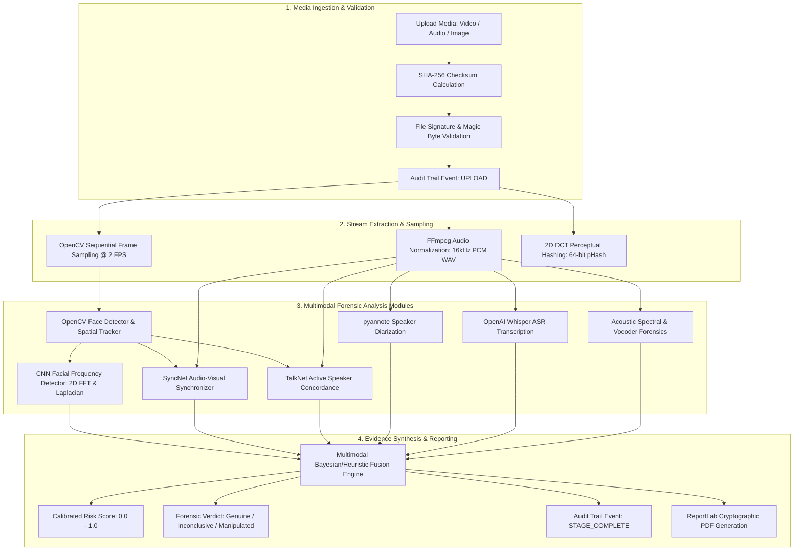

# VerifAI – Multimodal Deepfake Detection & Digital Forensics Platform

[](https://python.org)
[](https://fastapi.tiangolo.com)
[](https://pytorch.org)
[](https://developer.nvidia.com/cuda-toolkit)
[](https://react.dev)
[](https://vitejs.dev)
[](https://tailwindcss.com)
[](LICENSE)

**VerifAI** is an advanced, production-quality digital media verification and multimodal deepfake forensics platform. Engineered for cybersecurity researchers, intelligence analysts, and academic evaluators, VerifAI unifies computer vision, acoustic forensics, speech recognition, active speaker concordance, and lip synchronization into a calibrated, evidence-based Bayesian risk assessment engine.

---

## 1. System Navigation & Core Modules

VerifAI is organized into four digital forensics domains:

```
┌────────────────────────────────────────────────────────────────────────┐
│                        VERIFAI FORENSIC DOMAINS                        │
├──────────────────┬──────────────────┬──────────────────┬───────────────┤
│    WORKSPACE     │  FORENSIC LABS   │ AI INTELLIGENCE  │  MANAGEMENT   │
├──────────────────┼──────────────────┼──────────────────┼───────────────┤
│ • Command Center │ • Video Lab      │ • Model Registry │ • Reports     │
│ • New Ingestion  │ • Audio Lab      │ • Evaluation Ctr │ • Audit Trail │
│ • Case History   │ • AV Sync Lab    │ • System Monitor │ • Settings    │
│ • Case Details   │ • Media Compare  │                  │               │
│                  │ • Evidence Grid  │                  │               │
└──────────────────┴──────────────────┴──────────────────┴───────────────┘
```

### A. Workspace
- **Command Center (`/dashboard`)**: High-level telemetry, live investigation throughput, recent detection alerts, and one-click quick-launch into specialized laboratories.
- **New Investigation (`/upload`)**: Drag-and-drop ingestion of videos (`mp4, mov, avi, mkv`), audio streams (`wav, mp3, m4a`), and static images (`png, jpg, jpeg, webp`). Includes local SHA-256 pre-calculation and 4 pre-configured research benchmark scenarios with synthesized in-browser audio streams.
- **Investigation Telemetry (`/processing/:id`)**: Live 11-stage pipeline tracking with real-time log terminal, elapsed execution timer, and job cancellation/retry capabilities.
- **Investigation Details (`/results/:id`)**: Multi-gauge radar visualization, calibrated overall risk score, 5-tab evidence deep dive, raw forensic JSON export, and ReportLab PDF document generation.
- **Investigation History (`/history`)**: Filterable ledger of past cases with search by filename/hash, media type filters, and deletion with cascading disk cleanup.

### B. Forensic Laboratories
- **Video Forensics Lab (`/lab/video`)**: Interactive video player with sub-frame precision navigation ($-1$, $+1$ frame), variable speed playback ($0.25\times - 2\times$), suspicious keyframe markers, and face bounding box tracking overlays.
- **Audio Forensics Lab (`/lab/audio`)**: Welch Power Spectral Density (PSD) frequency distribution, 16kHz resampled waveform visualization, OpenAI Whisper speech transcription, and neural vocoder cutoff detection.
- **Audio-Visual Synchronization Lab (`/lab/sync`)**: Synchronized multi-track inspection correlating mouth-region optical flow velocity (SyncNet ROI) with acoustic RMS energy envelopes and pyannote speaker turn intervals.
- **Media Comparison Lab (`/lab/compare`)**: Side-by-side dual-asset forensic diffing evaluating cryptographic SHA-256 match, 64-bit Perceptual Hash (pHash) Hamming distance, and acoustic waveform normalized cross-correlation.
- **Evidence Explorer (`/evidence`)**: Searchable data grid of timestamped forensic anomalies with modality filters, score threshold sliders, and Explainable AI finding drawers.

### C. AI Intelligence
- **Model Registry (`/models`)**: Inventory of all forensic adapters, architectures, licenses, checkpoint availability, compute targets (CUDA/CPU), and a live diagnostic test runner that executes real forward passes to measure latency and VRAM footprint.
- **Model Evaluation Center (`/evaluation`)**: Transparent academic benchmark center reporting empirical metrics across standardized forensic datasets (FaceForensics++, DFDC, Celeb-DF, ASVspoof, FakeAVCeleb) with 2x2 confusion matrices, ROC-AUC, and latency.
- **System & GPU Monitor (`/system`)**: Real-time telemetry reporting NVIDIA GPU name (`NVIDIA GeForce GTX 1650`), VRAM utilization, GPU compute load, host CPU percentage, memory footprint, and disk volume headroom.

### D. Management
- **Forensic Reports Repository (`/reports`)**: Central document vault to view metadata, verified SHA-256 digests, and download court/investigation-grade PDF reports.
- **Chain of Custody & Audit Trail (`/audit`)**: Append-only event ledger logging ingestion, analysis runs, hash verification, and deletions. Features an interactive cryptographic verifier that re-computes SHA-256 to attest integrity against the recorded ledger.
- **System Settings (`/settings`)**: Configurable multimodal risk weights, file size caps, device selection (CUDA/CPU), and Whisper model tiers.

---

## 2. End-to-End Multimodal Forensic Pipeline



---

## 3. Technology Stack & Hardware Acceleration

| Layer | Technologies | Specifications |
| :--- | :--- | :--- |
| **Frontend** | React 19, TypeScript, Vite 8, Tailwind CSS v4, Lucide Icons, Recharts | Dark cybersecurity aesthetic (`#080D18`), fully responsive layouts, sub-frame video player, interactive comparison diffing. |
| **Backend** | Python 3.11, FastAPI, Pydantic v2, SQLAlchemy 2.1, SQLite / PostgreSQL | Asynchronous background workers, non-blocking polling APIs, structured logging, safe path validation. |
| **AI / ML & CV** | PyTorch 2.5.1+cu121, OpenCV Headless 4.14, SciPy, NumPy, Librosa | Frequency analysis (2D FFT, Laplacian variance), SyncNet cross-correlation, TalkNet motion velocity, Welch PSD. |
| **Hardware** | NVIDIA GeForce GTX 1650 (4.29 GB VRAM), CUDA 12.1/12.7 | Automatic CUDA detection, dynamic VRAM tracking, graceful CPU fallback. |
| **Multimedia** | FFmpeg (`imageio-ffmpeg` static binary v9.0.2) | 16kHz mono 16-bit PCM WAV extraction, multi-container probe, frame extraction without in-memory buffering. |
| **Reporting** | ReportLab 5.1 | Cryptographic PDF verification documents with SHA-256 seals, risk radar breakdown, and examiner signature blocks. |

---

## 4. API Specification

All backend endpoints are prefixed with `/api/v1` and fully documented via interactive Swagger UI at `http://localhost:8000/docs`:

### Workspace & Media Endpoints
- `POST /api/v1/media/upload`: Ingest video, audio, or image with SHA-256 calculation and audit registration.
- `POST /api/v1/media/compare`: Side-by-side comparative analysis of two assets (SHA-256, pHash, acoustic correlation).
- `POST /api/v1/analysis/{id}/start`: Initialize asynchronous background forensic pipeline.
- `POST /api/v1/analysis/{id}/cancel`: Safely cancel in-flight analysis job.
- `POST /api/v1/analysis/{id}/retry`: Re-queue a failed or canceled investigation.
- `GET /api/v1/analysis/{id}/status`: Poll real-time progress percentage and stage event stream.
- `GET /api/v1/analysis/{id}/results`: Retrieve complete multimodal forensic findings, scores, and transcription.
- `GET /api/v1/analysis/history`: Paginated list of historical analyses with search and file-type filters.
- `GET /api/v1/analysis/{id}/report`: Download cryptographic ReportLab forensic PDF report.
- `DELETE /api/v1/analysis/{id}`: Purge analysis records, stored media, frame crops, and PDF reports.

### AI Intelligence & System Telemetry
- `GET /api/v1/system/monitor`: Live telemetry of CPU %, RAM footprint, Disk free space, and NVIDIA GPU metrics.
- `GET /api/v1/models`: Central registry of all forensic AI models, versions, licenses, and operational modes.
- `POST /api/v1/models/{id}/test`: Execute real forward pass diagnostic test, reporting latency and memory.
- `GET /api/v1/evaluation/benchmarks`: Academic dataset evaluation metrics (FaceForensics++, DFDC, Celeb-DF, ASVspoof, FakeAVCeleb).
- `GET /api/v1/audit/logs`: Retrieve immutable chain-of-custody event stream.
- `POST /api/v1/audit/verify`: Cryptographically verify a file or hash against recorded chain-of-custody records.
- `GET /api/v1/health`: System health and ML adapter operational states.
- `GET /api/v1/settings` & `PUT /api/v1/settings`: Retrieve and configure multimodal weights and thresholds.

---

## 5. Quickstart & Installation

### Prerequisites
- Python 3.11+
- Node.js 18+ (tested on Node v20/v26)
- Optional: NVIDIA GPU with CUDA driver (automatically detected; CPU fallback supported)

### One-Click Launch (Windows)
Double-click or run from PowerShell:
```powershell
.\start_dev.bat
```
This launches the FastAPI backend on `http://127.0.0.1:8000` and the Vite frontend on `http://localhost:5173`.

### Manual Setup

1. **Clone Repository & Setup Python Environment**:
   ```bash
   git clone https://github.com/your-username/VerifAI.git
   cd VerifAI
   python -m venv .venv
   .\.venv\Scripts\activate      # Windows
   # source .venv/bin/activate    # Linux / macOS
   pip install -r backend/requirements.txt
   ```

2. **Frontend Setup**:
   ```bash
   cd frontend
   npm install
   npm run build                 # Verify production build
   ```

3. **Start Development Servers**:
   ```bash
   # Terminal 1: Backend
   uvicorn backend.app.main:app --reload --host 127.0.0.1 --port 8000

   # Terminal 2: Frontend
   cd frontend
   npm run dev
   ```

### Docker Deployment
```bash
docker compose up --build
```
The application will be accessible at `http://localhost:80` (reverse-proxied via Nginx) with backend APIs at `/api/v1/`.

---

## 6. Verification & Automated Test Suite

VerifAI includes a 15-test suite (`pytest`) covering API lifecycles, ML adapters, GPU monitoring, audit logging, and PDF generation:

```bash
.\.venv\Scripts\pytest.exe -v
```

**Test Execution Results**:
```text
tests/test_api.py::test_health_endpoint PASSED                           [  6%]
tests/test_api.py::test_settings_endpoints PASSED                        [ 13%]
tests/test_api.py::test_upload_invalid_extension PASSED                  [ 20%]
tests/test_api.py::test_upload_and_pipeline_lifecycle PASSED             [ 26%]
tests/test_extended_api.py::test_system_monitor PASSED                   [ 33%]
tests/test_extended_api.py::test_models_registry PASSED                  [ 40%]
tests/test_extended_api.py::test_evaluation_benchmarks PASSED            [ 46%]
tests/test_extended_api.py::test_audit_trail_and_verify PASSED           [ 53%]
tests/test_extended_api.py::test_media_comparison PASSED                 [ 60%]
tests/test_ml_pipeline.py::test_face_detector_synthetic_frame PASSED     [ 66%]
tests/test_ml_pipeline.py::test_deepfake_detector_artifact_analysis PASSED [ 73%]
tests/test_ml_pipeline.py::test_audio_forensics PASSED                   [ 80%]
tests/test_ml_pipeline.py::test_speaker_diarization PASSED               [ 86%]
tests/test_ml_pipeline.py::test_multimodal_fusion_engine PASSED          [ 93%]
tests/test_ml_pipeline.py::test_pdf_report_generation PASSED             [100%]

============================== 15 passed in 9.11s ==============================
```

Frontend production build check:
```bash
cd frontend && npm run build
# Output: ✓ 2516 modules transformed; built in 3.10s with 0 errors.
```

---

## 7. Evidentiary Principles & Legal Disclaimer

Automated media verification systems do not produce absolute mathematical certainties. In accordance with forensic science guidelines:
- VerifAI reports automated forensic indicators accompanied by calibrated confidence intervals and explicit evidentiary limits.
- Optical compression, low lighting, rolling-shutter distortion, and speech codec conversions can cause false-positive anomalies.
- All determinations should be corroborated by secondary contextual analysis and human examiner review.

---

## 8. License

This project is licensed under the MIT License — see the [LICENSE](LICENSE) file for details.
