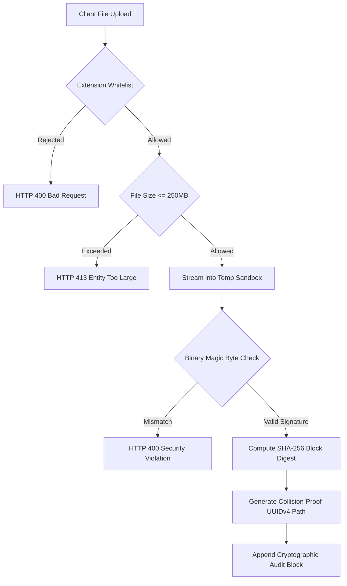

# Security Policy: VerifAI Digital Forensics Platform

**VerifAI** is designed with security and data integrity as foundational requirements. As a digital forensics platform handling potentially adversarial media files, the platform implements multi-layer defense-in-depth controls to protect the application, persistent storage, and forensic integrity.

---

## 1. Threat Model & Security Posture

Forensic verification software frequently encounters hostile payloads designed to exploit parser vulnerabilities, bypass access controls, or corrupt evidentiary audit trails. VerifAI guards against four key threat vectors:

1. **Malicious Ingestion & MIME Spoofing**: Attackers attempting to upload executable scripts or polyglots disguised as video or audio files.
2. **Path Traversal & Shell Injection**: Attackers supplying manipulated filenames (`../../etc/passwd` or `video; rm -rf /`) to compromise host filesystem security.
3. **Chain-of-Custody Tampering**: Adversaries attempting to alter, delete, or fabricate audit trail records to invalidate forensic evidence.
4. **Denial of Service (DoS)**: Attackers submitting excessively large or malformed media to exhaust CPU, RAM, GPU VRAM, or storage capacity.

---

## 2. Ingestion Defense & Magic Byte Validation

All file uploads are validated before any processing, disk persistence, or model inference takes place.

### File Validation Pipeline



### Magic Byte Reference Specifications

| Format | Extension | Required Magic Header Signature | Forensic Rule |
| :--- | :--- | :--- | :--- |
| **MP4 / MOV** | `.mp4`, `.mov` | `offset 4..8` in `b"ftyp"`, `b"moov"`, `b"mdat"` | Rejects renamed non-ISO BMFF files |
| **MKV / WebM** | `.mkv`, `.webm`| `b"\x1a\x45\xdf\xa3"` (EBML Header) | Rejects spoofed Matroska containers |
| **AVI** | `.avi` | `b"RIFF....AVI "` | Validates 12-byte RIFF chunk descriptor |
| **WAV** | `.wav` | `b"RIFF....WAVE"` | Enforces canonical RIFF WAVE format |
| **MP3** | `.mp3` | `b"ID3"` or `0xFF` + `(byte[1] & 0xE0) == 0xE0` | Validates ID3v2 or MPEG frame sync |
| **FLAC** | `.flac`| `b"fLaC"` | Requires native FLAC stream marker |
| **PNG** | `.png` | `b"\x89PNG\r\n\x1a\n"` | 8-byte canonical PNG signature |
| **JPEG** | `.jpg`, `.jpeg` | `b"\xff\xd8\xff"` | JPEG SOI (Start of Image) marker |
| **WebP** | `.webp`| `b"RIFF....WEBP"` | Validates WebP container header |

Files failing signature checks are purged from the filesystem immediately, returning an `HTTP 400 Bad Request` with an explanatory forensic security alert.

---

## 3. Cryptographic Chain of Custody

The evidentiary integrity of investigations is secured using SHA-256 cryptographic hash-chaining:

- Every event is signed with its parent block's hash:
  $$\text{Hash}_i = \text{SHA-256}\Big(\text{Hash}_{i-1} \parallel \text{Timestamp} \parallel \text{EventType} \parallel \text{InvestigationID} \parallel \text{AssetSHA256} \parallel \text{Action} \parallel \text{Status} \parallel \text{Actor}\Big)$$
- Genesis block starts at $0^{64}$.
- Any modification of database records triggers an integrity violation during verification.
- **Verification Endpoint**: `GET /api/v1/audit/verify-chain` verifies every block from genesis to the current chain head.

---

## 4. HTTP Security Headers

The FastAPI gateway injects enterprise-grade security headers on all responses:

```http
X-Content-Type-Options: nosniff
X-Frame-Options: SAMEORIGIN
X-XSS-Protection: 1; mode=block
Referrer-Policy: strict-origin-when-cross-origin
```

---

## 5. Resource Limits & GPU Sandboxing

- **Maximum Upload Size**: Enforced at 250 MB (`MAX_UPLOAD_SIZE_MB`).
- **GPU VRAM Cleanup**: Explicit invocation of `torch.cuda.empty_cache()` after inference batches prevents CUDA out-of-memory cascades on entry-level GPUs (such as the 4GB NVIDIA GeForce GTX 1650).
- **Storage Lifecycle Policy**: Automated retention cleanup via `POST /api/v1/system/cleanup` periodically purges temporary verification artifacts and orphaned frame caches.

---

## 6. Reporting a Security Vulnerability

If you identify a security vulnerability in VerifAI, please report it via private security advisory on GitHub or email the development team. Please do not publish security disclosures publicly until a patch has been made available.

